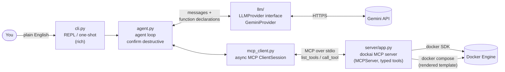
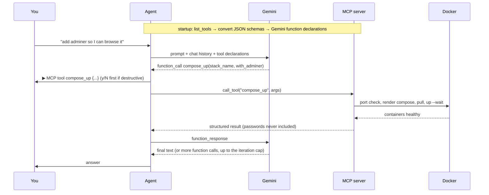

# mcp-docker-automation (`dockai`)

Manage Docker containers in plain English. You type a request in your terminal, an LLM picks the
right [MCP](https://modelcontextprotocol.io) tool, and Docker does the work. You never type a
docker command yourself, and every tool call is printed (with its arguments) before it runs.

Sibling of [Mcp-Github-Automation](https://github.com/mahdibani/Mcp-Github-Automation): same idea
(Gemini function calling wired to an async MCP server), now with runtime tool discovery, a
provider interface, a multi-step agent loop, and guardrails for a tool that can delete things.

## Demo

A real session (Windows 11, Docker Desktop), condensed: JSON result panels are shortened.

```text
dockai> spin up a postgres 16 database called shop_db with user igor on port 5432
▶ MCP tool check_port {"port": 5432}
▶ MCP tool compose_up {"user": "igor", "postgres_port": 5432, "stack_name": "shop_db",
                       "database": "shop_db", "postgres_version": "16"}
┌─ compose_up → ok ──────────────────────────────────────────────────────────────────┐
│ "ready": true, "name": "shop_db-postgres", "health": "healthy"                     │
│ "connection": {"host": "localhost", "port": 5432, "user": "igor", "password": "********"} │
└────────────────────────────────────────────────────────────────────────────────────┘
┌─ dockai ───────────────────────────────────────────────────────────────────────────┐
│ The Postgres 16 database stack shop_db with user igor is up and running on port    │
│ 5432. The password has been securely stored in the stack's .env file.              │
└────────────────────────────────────────────────────────────────────────────────────┘

dockai> is it running?
▶ MCP tool container_status {"name": "shop_db"}
│ Yes, the shop_db container is running and healthy, currently accepting connections on port 5432.

dockai> show me the last 30 lines of its logs
▶ MCP tool get_logs {"name": "shop_db", "tail": 30}
│ ... raw log lines ...
│ 2026-10-11 23:31:20.360 UTC [1] LOG:  database system is ready to accept connections
│ The logs show that the initialization completed successfully, the database was created,
│ and PostgreSQL started up cleanly and is ready to accept connections.

dockai> add adminer so I can browse it in the browser
▶ MCP tool check_port {"port": 8080}            ← 8080 is taken on this machine
▶ MCP tool compose_up {"with_adminer": true, "adminer_port": 8081, "stack_name": "shop_db"}
│ Adminer has been added to the shop_db stack. Since port 8080 was in use, it is available
│ on port 8081 instead.
│  • URL: http://localhost:8081   • System: PostgreSQL   • Server: postgres
│  • Username: igor   • Database: shop_db   • Password: (saved in the stack's .env file)

dockai> stop and remove everything you created
▶ MCP tool compose_down {"stack_name": "shop_db", "delete_volumes": true}
Destructive action compose_down. Proceed? [y/N] y
▶ MCP tool list_containers {"only_managed": true, "include_stopped": true}
│ All containers, networks, and volumes created by dockai (shop_db stack) have been
│ successfully stopped and removed.
```

Containers on the machine that dockai did not create were never touched.

## Architecture





## How it works (the 60-second version)

1. **Two processes, one protocol.** `dockai` (the client) starts the dockai MCP server as a child
   process and talks to it over stdio using the official `mcp` Python SDK. The server exposes typed
   Docker tools (`compose_up`, `get_logs`, `compose_down`, …) built with `MCPServer` (the
   SDK's FastMCP) and the `docker` Python SDK.
2. **No hardcoded tools.** At startup the client calls `list_tools()`. Each tool's JSON Schema is
   converted into a Gemini function declaration (`llm/gemini_schema.py`): `$ref`s are
   inlined, `anyOf [X, null]` becomes `nullable`, and unsupported keys are dropped. Add a tool on
   the server and the LLM can use it on the next run, with no client change.
3. **Agent loop.** The prompt goes to Gemini with the declarations. If Gemini answers with function
   calls, the agent prints each one, asks y/n when the tool is annotated `destructive_hint`, runs it
   over MCP, and sends the results back. This repeats until Gemini answers in text or the
   `--max-iterations` cap is hit. The chat keeps history, so "is it running?" knows what "it" is.
4. **Provider interface.** The agent only knows `LLMProvider` / `ChatSession` (`llm/base.py`).
   Gemini lives behind it, with retries and automatic fallback to other models on 503/429.
   Swapping in another model means one new class.
5. **Safety lives in the server, not the prompt.** Everything dockai creates is labelled
   `managed-by=dockai`, and stop/remove/prune refuse anything without the label, whatever the
   LLM asks for.

## Setup (Windows 11, PowerShell or cmd)

Requirements: Docker Desktop (running), [uv](https://docs.astral.sh/uv/), and a Gemini API key from
[Google AI Studio](https://aistudio.google.com/apikey). uv downloads Python 3.12 by itself.

```powershell
git clone https://github.com/mahdibani/Mcp-Docker-Automation.git
cd Mcp-Docker-Automation
uv sync
copy .env.example .env
notepad .env          # set GEMINI_API_KEY=...
uv run dockai --list-tools
```

## Usage

```powershell
uv run dockai                                         # interactive REPL (type exit to quit)
uv run dockai "is anything running?"                  # one-shot
uv run dockai --yes "remove everything you created"   # skip y/n confirmations
uv run dockai --list-tools                            # show discovered MCP tools
uv run dockai-server                                  # run the MCP server alone (stdio)
```

Exit codes: `2` MCP server unreachable or key missing, `3` LLM unavailable, `4` Docker not running.

### Tools exposed by the server

| Tool | Kind | What it does |
|---|---|---|
| `docker_status` | read-only | Is the daemon reachable, which version |
| `list_containers` | read-only | Containers with status, health, ports (optionally only dockai's) |
| `container_status` | read-only | One container: running, health check output, start time |
| `get_logs` | read-only | Last N log lines |
| `check_port` | read-only | Is a host port free, else suggest the next free one |
| `run_container` | write | Any single image, labelled, ports bound to 127.0.0.1 |
| `compose_up` | write | Create/update a Postgres stack (optionally + Adminer), wait for healthy |
| `stop_container` | write | Stop a dockai container |
| `remove_container` | **destructive** | Remove a dockai container |
| `compose_down` | **destructive** | Remove a stack, optionally its data volume |
| `prune_managed` | **destructive** | Remove everything labelled `managed-by=dockai` |

## Guardrails

- **Label scoping:** every container, volume and network gets `managed-by=dockai`. The server refuses
  to stop or remove anything without it (`Refusing: container 'x' was not created by dockai`).
- **Confirmation:** tools annotated `destructive_hint` need a y/n answer; `--yes` skips it. A "no" is
  sent back to the LLM as a declined action, so it doesn't retry.
- **Ports:** checked before starting (socket connect and exclusive bind, which also catches
  Windows-reserved ports, plus ports published by containers). On a conflict the tool returns a
  free port and the agent retries with it and tells you. A stack's own ports count as free when it
  is updated.
- **Ready means healthy:** Postgres has a `pg_isready` healthcheck; `docker compose up --wait`
  blocks until it passes. Adminer waits for `service_healthy`.
- **Retries with exponential backoff:** Docker daemon connection, image pulls, Gemini 503/429.
  When a Gemini model's *daily* quota is used up, it is skipped for the session.
- **Clear failures:** Docker Desktop not running, MCP server unreachable or LLM unavailable each
  produce a one-line message and a distinct exit code, never a stack trace.
- **Secrets:** the Postgres password comes from `POSTGRES_PASSWORD` in `.env` or is generated per
  stack, stored in `.dockai/stacks/<stack>/.env` (git-ignored), passed to the container through
  `env_file`, and never returned by a tool. Anything password-like is masked before printing.

## Configuration (`.env`)

| Variable | Default | Purpose |
|---|---|---|
| `GEMINI_API_KEY` | (none) | required |
| `GEMINI_MODEL` | `gemini-3.8-flash` | main model |
| `GEMINI_FALLBACK_MODELS` | `gemini-3.7-flash,gemini-3.5-flash,gemini-3.5-flash-lite,gemini-3.1-flash-lite` | tried in order on 503/429 |
| `POSTGRES_PASSWORD` | generated | password for new stacks |
| `DOCKAI_ADMINER_PORT` | `8080` | default Adminer host port |
| `DOCKAI_MAX_ITERATIONS` | `8` | LLM ↔ tool round trips per request |
| `DOCKAI_MCP_COMMAND` | `python -m dockai.server` | MCP server to connect to (e.g. `docker mcp gateway run`) |

The Gemini free tier allows about 20 requests per day per model, and each prompt costs 2–3 requests.
The fallback list spreads the load across models.

## Why our own MCP server and not the Docker MCP Toolkit catalog?

Before writing any code, I checked the Docker MCP Toolkit (v0.43) catalog of 314 servers. None of
them manages local containers: the closest are Docker Hub (registry metadata), Kubernetes, and
`desktop-commander` (runs arbitrary shell commands, which would bring back "the LLM types docker
commands" with no label scoping). So dockai ships a small typed server instead. The client is not
tied to it: `DOCKAI_MCP_COMMAND` can point at any stdio MCP server, including
`docker mcp gateway run`, and tools are discovered at runtime either way.

## Development

```powershell
uv run pytest -q
```

43 tests, no Docker or API key needed: schema conversion (including every real server tool
validated against google-genai's `FunctionDeclaration`), the agent loop with a mocked MCP
`ClientSession` (chains, parallel calls, confirmation/decline/`--yes`, tool errors, unknown tools,
the iteration cap), compose rendering and labels, secret masking, backoff, and port checks.

```text
src/dockai/
  cli.py                 REPL, one-shot, rich output, confirmations
  agent.py               agent loop + system prompt
  mcp_client.py          async stdio MCP client, tool discovery, result parsing
  llm/base.py            provider-neutral interface
  llm/gemini.py          Gemini provider: retries, model fallback
  llm/gemini_schema.py   JSON Schema → Gemini declarations
  server/app.py          MCP server: typed Docker tools
  server/compose_ops.py  stack files + docker compose
  server/docker_ops.py   docker SDK connection, summaries
  server/ports.py        port checks
  compose/               stack template (Jinja2) + validation
  redact.py, retry.py, config.py
tests/
```
